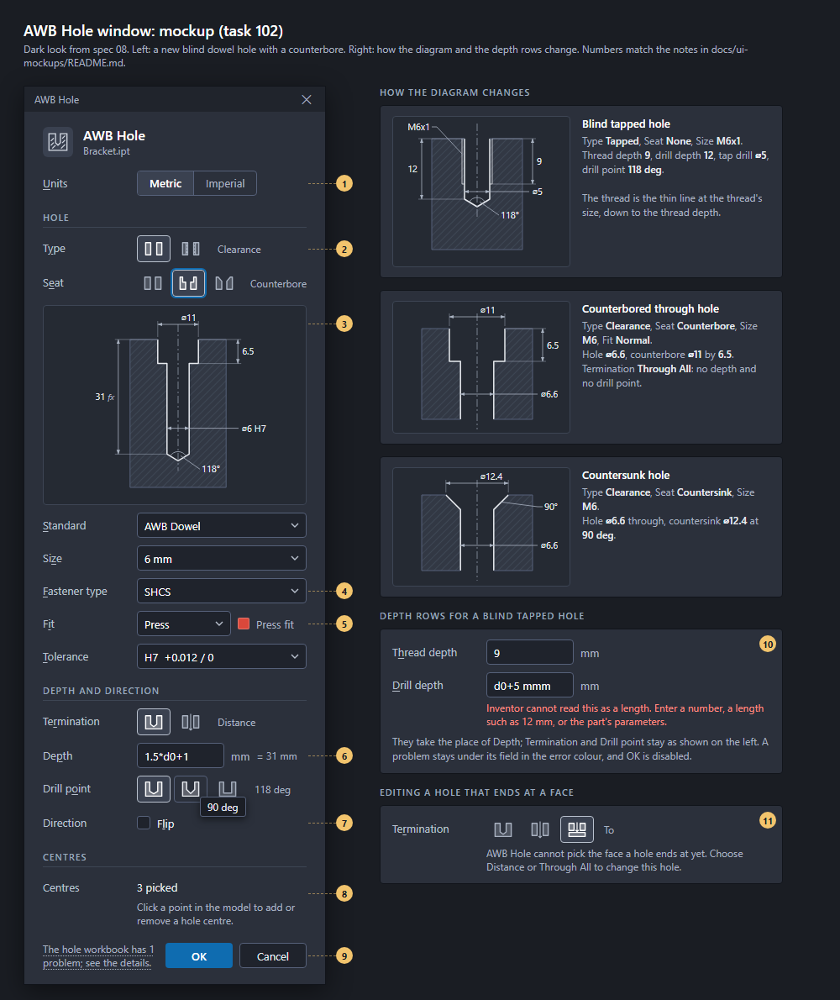

# UI Mockups

Drop screenshots / sketches of the desired UI here. Name them so they sort and
describe the screen, e.g.:

- `01-ribbon-tab.png`
- `02-part-number-dialog.png`
- `03-material-finish-library.png`
- `04-hole-table-tool.png`

If a picture needs explanation (behavior, which fields are editable, where data
comes from), add a matching `.md` file with the same name.

## AWB Hole window (task 102)

`awb-hole-window.png` is rendered from `awb-hole-window.html` with headless Edge (the command is in a comment at the top of the HTML). The hole diagrams are drawn by a script in the HTML from each hole's values, so a value or the layout can be changed and the PNG rendered again. Every icon and diagram was drawn for this mockup; nothing is taken from Inventor or any other software. The look is spec 08's dark set: its colours, Segoe UI 13, 100-wide label column, 30-high controls, 9 between rows, 18 between sections.

Left is a new blind dowel hole with a counterbore (Clearance, AWB Dowel, 6 mm, SHCS, Press, H7, depth `1.5*d0+1`, 118 deg, three centres). Right are the diagram for a blind tapped hole, a counterbored through hole and a countersunk hole; the depth rows of a blind tapped hole, with a problem under a field; and the Termination row of an edited hole that ends at a face. The note shown at the top of the body for a hole made by Inventor's Hole command is not drawn; it stays where it is today. Values are made up.

Choices that are ours to make, numbered as in the image. Comment on any of them by number.

1. **Units** is a two-part toggle (Metric, Imperial) on its own row above the sections, in place of a dropdown.
2. **Icon buttons** for Type, Seat, Termination and Drill point: 40 by 32, icon only, a tooltip with the name (shown on the 90 deg button). The icons show the part in section, material shaded and the hole left empty. The chosen button has the icon tile fill and a lighter border, not the accent colour, which spec 08 keeps for the primary button and keyboard focus (the Seat button shows focus). The chosen name is repeated in muted text after the buttons so the row reads without hovering.
3. **The diagram** sits in the Hole section under Type and Seat, the full width of the content (about 314 by 236), on a slightly darker panel. It is a section view: the part hatched, the hole outline in the text colour, a centre line, dimension lines in the muted colour with their values. It shows the hole diameter with its tolerance (`⌀6 H7`), the depth, the seat (counterbore diameter and depth, or countersink diameter and angle), the thread as a thin line with its depth and the thread size (tapped), and the drill point angle. A depth typed as an expression shows its value with a small *fx*. A through hole has no depth or point. The diagram is not drawn in the fit colour, and it follows the light or dark theme like the rest of the window.
4. **Fastener type moves under Size** (task 099: its list depends on the size). Shown only for a seated hole, as now.
5. **The fit colour** sits on Fit's own row, beside a narrower dropdown, instead of a line under it.
6. **Depth boxes** show the text as typed, the unit after the box, and the value it comes to in muted text (`= 31 mm`) when the text is an expression. Thread depth and Drill depth work the same way.
7. **Direction** stays a Flip checkbox, not an icon button.
8. **Centres** is unchanged: the count, then how to pick.
9. **Footer** is unchanged: the status line on the left (its tooltip lists every note; the example is a workbook problem), OK and Cancel. The 3D preview in the model stays solid red (Aidan, spec 09 question 13); the window says nothing about it.
10. **A blind tapped hole** shows Thread depth and Drill depth in place of Depth. A field's problem stays under it in the error colour.
11. **To** is a third Termination button only for an edited hole that already ends at a face, with the note under it, as today.

Kept from spec 08 and today's window: the header with the icon tile, title and file name; the section headings Hole, Depth and direction, Centres; a field that does not apply is not shown; the access keys. The window is 360 wide, a little wider than Inventor's Hole panel, because spec 08's label column is 100 wide; a narrower label column (for example 84) would make it about 345.
